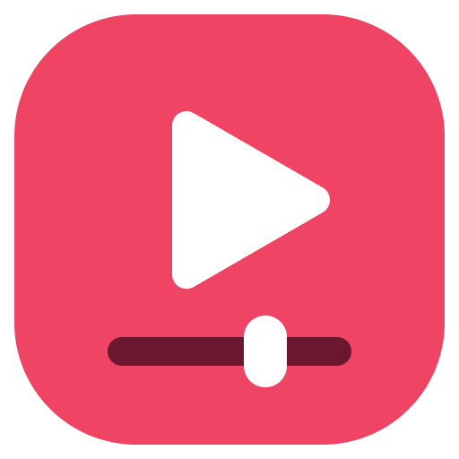

  
  <h1>🌸 YouTube Customizer</h1>
  
<strong>Make YouTube look and feel like your own.</strong>

  

    <kbd>🧩 Manifest V3</kbd>
    <kbd>🌐 Chrome</kbd>
    <kbd>🌐 Microsoft Edge</kbd>
    <kbd>🎨 Live preview</kbd>
  

> Customize YouTube's appearance, player, and layout. Changes are previewed on the current YouTube tab as you adjust the settings.

## ✨ Features at a glance

| Section | What you can customize |
| --- | --- |
| 🎨 **Appearance** | Page theme, colors, opacity, frosted glass, background images, GIFs, and silent MP4 videos |
| ▶️ **Player** | Progress and buffer colors, bar thickness, scrubber shape, and effects |
| 🧩 **Layout** | Video grid, hover previews, Shorts, sidebar, comments, and live chat |

### 🎨 Appearance

- Choose the **Charcoal**, **Light**, **Forest**, or **Windows Classic** theme, or set your own page, surface, text, and accent colors.
- Adjust UI opacity from 0–100% and frosted-glass blur from 0–30 px.
- Buttons on YouTube pages keep white labels over translucent glass, including player controls, menus, filters and timeline-note actions. Opacity and blur follow the page settings; buttons in frosted panels share the panel's blur. The settings menu keeps its separate light/dark design.
- Upload a background image, GIF, or MP4 video up to 20 MB, choose Fill or Fit, and adjust its opacity. Images can also be tiled. MP4 videos loop silently.
- YouTube ambient lighting is suppressed while a custom background is active.
- In theater mode (T), the empty space around the video reveals your wallpaper with the current UI blur setting.
- YouTube Music shares the same themes and wallpapers, with individual frosted song, video, and album cards, plus themed navigation, menus, the player bar, and the queue. Section and channel titles have fitted rounded borders; video and album cards inset their artwork and captions within rounded edges. Play all/More controls, carousel arrows, genre tiles, and Explore shortcuts share the theme. The gaps between cards reveal the wallpaper. Its native carousels and song controls keep their layout; theme updates do not scan the page during playback.

### ▶️ Player

- **Timeline notes:** click the thin strip just above the player's progress bar to pin that position and open a yellow sticky note. **＋ Note** adds one at the current playback time. Write an optional multiline note and save; click its gold pin to read, edit, delete or jump to that timestamp. Opening a note does not seek or pause the video; normal timeline scrubbing stays available. Notes remain in the player in normal, theater and fullscreen views, and fit the player on small screens. Existing records persist locally per video and update across tabs showing the same video. **Records → Show video bookmarks** hides the notes and pins without deleting records. Local notes are separate from the settings JSON backup. Ads and live streams cannot create or use timestamps.
- The dedicated **Records** tab groups **Video bookmarks** and **Timeline record statistics**. Statistics show the number of locally recorded videos, total timeline points and points containing a written sticky note. They also show the current video's record count, with an optional list sorted by time. Saved and deleted records update these read-only totals automatically; an independent settings window stays bound to its original video tab as it navigates. Empty and malformed records are excluded. Statistics load only while Records is open and avoid loading stored wallpapers where the browser supports key-only storage enumeration. Search for “statistics” or “统计” to reach the section. Resetting the Records tab restores its display preference and preserves saved records.
- In **Player → Picture-in-picture**, click **Open floating video** to open the current video in a native floating window. Click **Return video to tab** to close it. Both the in-page menu and separate settings window support this action; wallpapers and thumbnail previews are excluded, and playback position, volume, and mute are preserved.
- A Picture-in-picture icon also appears at the left edge of the player's right-hand controls, before CC/settings, so you can open or close the floating video without opening the extension menu. It follows the native controls in theater/fullscreen mode and returns when YouTube rebuilds its player controls.
- Customize progress and buffered-segment colors, progress-bar thickness, and scrubber size.
- Choose a separate color for the **Most replayed** heatmap, including its gradient and outline.
- Choose a solid color, pulsing glow, moving shimmer, or cycling rainbow effect.
- Pick a built-in scrubber shape or upload a custom image or GIF.
- The independent **Shortcuts** tab contains the current bindings, **Use default shortcuts on YouTube**, and **Change shortcuts...**. Defaults are **Alt+Shift+Y** for the menu, **Alt+Shift+P** for picture-in-picture, and **Alt+Shift+A** for audio enhancement. Browser-assigned shortcuts always take priority. If a command is unassigned, the defaults option (enabled initially) activates its default within YouTube and labels it **YouTube default**. Turn it off to disable these page defaults; **Change shortcuts...** opens the browser editor to change or clear browser bindings. Defaults ignore typing, composition, repeated keys, editors and focused chat frames. Resetting the tab restores the defaults option without changing browser bindings or Player settings.
- The shortcut section wraps long labels and key combinations. Short settings windows scroll the form as a whole, so labels, help text and the edit button remain reachable instead of being cut by a small inner panel.

### Audio

- Open the separate **Audio** tab to enable volume boost up to **500%**, adjust bass, midrange, treble, and stereo balance, and optionally reduce clipping. Audio processing starts off; disabling it restores normal audio. Wallpaper and thumbnail previews are excluded.
- **Live audio** shows stereo RMS bars, peak levels in dBFS, YouTube volume, and the currently applied boost, EQ, balance, and limiter reduction. Sampling runs only while the Audio tab is visible and stops automatically after the menu closes. The meter uses the existing audio path; enable enhancement and play a supported video to start measuring. It does not measure the operating system's speaker volume.
- **Reset tab** on Audio resets audio settings independently from Player and Appearance.

### 🧩 Layout and browsing

- Set Home videos and Shorts to 2–6 items per row, with fewer columns on narrow windows. Disable hover previews or reduce motion.
- Enable **Customize card layout** to adjust corner radius, border width, padding, gaps, section spacing, title lines, and equal row heights. Compact Music lists retain their native row height.
- Home Premium image and single-video promotions share the rounded glass frame, inset artwork and text, and section spacing. Their content wraps on narrow windows; video cards keep their own inset frame and usable menus.
- At the top of **Layout → Home sections**, independently hide **single-video promotions** or **YouTube Playables games**. The all-featured/membership/Premium option includes single-video promotions; topic and shopping recommendations have their own switches. Hidden sections release their feed space. These choices are saved with the selected page configuration and work with the theme turned off.
- Home Shorts initially show one row. Show more reveals the additional cards; changing the column setting collapses the shelf again.
- Shorts cards in both classic and modern Home shelves use equal-width columns and matching 2:3 thumbnail frames, including modern lockups inside classic rich-shelf wrappers. Equal row heights reserves the configured title lines so view counts align below the thumbnails.
- Library pages use rounded panels and cards with the shared theme background, opacity, and blur: History, Playlists, Watch later, Liked videos, Downloads, Courses, and Clips.
- Channel memberships has a themed header, wrapping topic filters, rounded video and creator cards, and clearly separated section headings. Creator names and prices appear below their artwork.
- Hide Shorts, topic filter bars (including the filters above recommended videos), the Create button, or the notifications button. Hiding a filter removes its frame and reserved space, including while recommendations are loading.
- Independently hide Subscriptions, You, Explore, More from YouTube, and Report history in the sidebar.
- Adjust related-video thumbnail width, or hide related videos (including their filter bar), comments, or live chat.
- Watch-page recommendation filters use an inset rounded frame, aligned 32 px chips and circular arrows. The filter shares the recommendation panel's glass instead of stacking extra backgrounds and blur. Native filtering and horizontal scrolling remain available; labels stay clear of the arrow controls. Styling is scoped to watch recommendations and restores with the page theme disabled.

### Page settings and backups

- Click the **YouTube Customizer icon immediately to the left of your YouTube avatar** to open the complete settings menu in a dialog on the page. The browser extension button and its menu shortcut open the same dialog on YouTube. The modern interface supports light and dark themes, coral accents, rounded controls and matching line icons. Wide windows show category navigation in a sidebar; narrow windows use horizontal tabs. Text, buttons, fields, sliders, checkboxes, spacing and previews scale together. Short windows let the form scroll so its footer remains reachable. The responsive dialog keeps at least 12 px clear around its edges. Use the top-right **×**, the bottom **Close** button, Escape, or the backdrop to close it; pending edits are saved first. The dialog stays bound to its original YouTube tab.
- Use **Editing settings for** to edit shared settings or separate appearance and layout for **YouTube Home**, **Watch pages / Shorts**, and **YouTube Music**. Editing a page creates its override; turn off **Use separate appearance and layout** to return to shared settings. Player and Audio settings are shared.
- Each page can have its own wallpaper. Page configurations and uploaded media are stored locally; shared settings continue to use browser sync storage.
- Click **Open window** in the menu title bar to move the entire settings menu into a separate, resizable browser window. It keeps your selected settings tab and page configuration, previews on the originating YouTube tab, and remains open while you browse. Clicking Open window again reuses the existing window.
- The title-bar language selector supports **Auto / 自动**, **中文**, and **English**. Auto follows the browser's interface language; the choice is stored locally and shared by the in-page menu and independent windows. Labels, live audio readouts, status messages, and error hints switch immediately without reapplying the YouTube theme.
- The **Menu theme** selector in the title bar offers **System theme**, **Light mode**, and **Dark mode**. System theme follows the device preference and responds to changes. Explicit choices persist locally and update all open menus, including the embedded dialog surface and independent windows. Search for “dark mode” or “菜单主题” to focus this selector. This menu-only preference does not change the YouTube page theme or uploaded wallpaper.
- The **Backup** tab exports shared settings and all page configurations as JSON, with an option to include wallpapers and the custom icon. Import validates the file and replaces settings; a backup without media preserves existing media files. Backups support up to 150 MB.
- Dropdown fields and their expanded lists use rounded borders, subtle shadows and coral selection. They remain native select controls for keyboard and accessibility support. Category navigation supports arrow keys, Home and End.
- The seven settings categories are **Appearance**, **Player**, **Records**, **Shortcuts**, **Audio**, **Layout**, and **Backup**. Small screens arrange navigation in a compact grid to keep labels readable. Search at the top finds settings in English or Chinese, including option names and aliases such as PiP, wallpaper, and Playables. Click a result to switch categories, focus and highlight the setting. Search does not change values; disabled options lead to the related enable control. **Ctrl+F / Command+F** focuses search, arrow keys move through results, Enter selects, and Escape clears the query.
- The in-page menu uses one frosted-glass surface with a subtle view of the actual YouTube content or wallpaper. Header, sidebar, groups and footer share that surface, with simple separators instead of overlapping translucent cards. Controls, search results and dropdowns use solid surfaces for readable contrast in both modes. Theme changes apply immediately without leaving old highlights or restarting the page theme. Standalone windows use the matching light or dark canvas.
- Connection upgrades preserve the open dialog and its authenticated iframe. Backdrop dismissal requires a click that starts outside the dialog, so finishing a slider drag outside does not close it. Range previews are combined once per animation frame, reuse unchanged media, and flush the final value on release or close. Focus reloads configuration only after stored values change.
- The new coral play-and-slider icon appears in the browser toolbar, YouTube header and settings menu. `icons/logo-mark.svg` is the editable vector master; run `node scripts/build-icons.cjs` with Playwright available (or `PLAYWRIGHT_MODULE` set to its module path) to rebuild all PNG sizes.

## 🚀 Installation

YouTube Customizer is a Manifest V3 extension for Chromium-based browsers, including Google Chrome and Microsoft Edge.

1. Download or clone this project and extract it to a folder on your computer.
2. Open the extensions page: enter `chrome://extensions` in Chrome or `edge://extensions` in Edge.
3. Turn on **Developer mode**.
4. Select **Load unpacked**.
5. Choose the project root folder containing `manifest.json`.
6. Open YouTube and find the YouTube Customizer button just to the left of your avatar.

## 🪄 Getting started

1. Open YouTube and click the YouTube Customizer button beside your avatar to open the settings dialog on the page.
2. In **Appearance**, enable **Enable page theme**, choose a theme, and adjust its colors, opacity, or blur.
3. In **Wallpaper**, upload a background image, GIF, or MP4 video. In **Player**, customize the progress bar and scrubber.
4. In **Audio**, enable volume boost and adjust the equalizer or stereo balance.
5. In **Layout**, hide page elements or adjust the video layout as needed.
6. Changes are previewed live and saved automatically. Use **Reset tab** to reset the current settings section, or **Reset all** to restore the default settings.

## 🖼️ Backgrounds and settings storage

- Backgrounds support PNG, JPEG, WebP, AVIF, GIF, and MP4 up to **20 MB** per file. GIF animation is preserved; MP4 videos loop with sound permanently muted.
- Custom scrubber icons support PNG, JPEG, WebP, AVIF, and GIF up to **5 MB**.
- The `unlimitedStorage` permission lets the extension save 20 MB backgrounds after they are encoded for browser storage.
- Theme and layout settings are stored in browser sync storage. Whether they sync across devices depends on your browser account's sync settings.
- Uploaded backgrounds and custom scrubber images are stored locally in the current browser and do not sync with your settings.

## 🔄 Updating

After changing or updating the project files, open the browser's extensions page and click the extension's **Reload** button. Then refresh any open YouTube tabs.

Opening or focusing the settings menu preserves the active theme and wallpaper. Settings are previewed when you edit them; content-script upgrades load the saved configuration before replacing the active instance.

  
🛠️ Frequently asked questions

  **Settings are not being applied to YouTube.**

  Make sure the active tab is open to YouTube. After reloading the extension, refresh the YouTube page.

  **My background image did not sync to another browser.**

  Backgrounds and custom scrubber images are stored locally. Theme and layout settings are the items saved to browser sync storage.

  **How do I undo my changes?**

  Use **Reset tab** to reset the current settings section, or **Reset all** to restore all default settings.

## 📁 Project structure

| File / folder | Purpose |
| --- | --- |
| `assets/logo.png` | Modern project logo |
| `icons/` | Editable logo and UI SVGs, with extension PNGs at 16, 32, 48, and 128 px |
| `manifest.json` | Extension metadata, icons, permissions, and content-script configuration |
| `settings.js` | Default settings, validation, and theme presets |
| `popup.html`, `popup.css`, `popup.js` | Extension settings popup |
| `i18n.js` | Chinese/English menu copy, local language preference, and dynamic text translation |
| `settings-search.js` | Bilingual search and navigation through the existing settings form |
| `service-worker.js` | Browser shortcut actions, typing guards, and brief action feedback |
| `yt.js`, `content/` | YouTube page styling and feature controllers |
| `content/home-shorts-grid.js` | Homepage Shorts columns; updates on shelf structure changes and detaches outside Home |
| `content/audio-controller.js` | Player volume boost and equalizer; native Web Audio nodes with normal-audio bypass |
| `content/music-theme.js` | YouTube Music appearance and layout; CSS surfaces without playback-time scans |
| `tests/` | Regression and browser smoke-test scripts |

  🌸 Add a little of your own style to YouTube.

